<div align="center">
  
  

[Portfolio](https://amannishad-ic.github.io/aman-portfolio/) · [GitHub](https://github.com/AmanNishad-ic) · [LinkedIn](https://www.linkedin.com/in/aman-nishad-6a0439414/) · [Email](mailto:amannishad.ic@gmail.com)

</div>


## Engineering intelligence

I am an AI Engineer at **Swenta Solutions**, based in Mumbai, India. I build intelligent applications with Python, Machine Learning, Generative AI and Agentic AI. My hands-on work spans LLM applications, document RAG, semantic search, vector retrieval, multi-agent research workflows and automated data processing. I focus on practical AI backend development and turning complex problems into useful software.

## Featured engineering projects

[](https://github.com/AmanNishad-ic/researchmind-ai)

**[ResearchMind AI](https://github.com/AmanNishad-ic/researchmind-ai)** — Research automation with Tavily search, webpage extraction, report generation and separate critic feedback. Python, LangChain, Mistral and Streamlit.

[](https://github.com/AmanNishad-ic/agentic-ai)

**[Document RAG](https://github.com/AmanNishad-ic/agentic-ai)** — PDF chunking, embeddings, ChromaDB, semantic and MMR retrieval, and context-aware Mistral responses.

[](https://github.com/AmanNishad-ic/mlops_batch_job-)

**[MLOps Batch Processing](https://github.com/AmanNishad-ic/mlops_batch_job-)** — YAML-driven ingestion, cleaning, transformation, validation, logging, metrics and Docker containerization.


**Car Price Prediction** — Linear regression with preprocessing, feature engineering and categorical encoding. Resume-reported R²: 0.8045, MAE: 0.2596, RMSE: 0.3502. Plot is illustrative; dedicated repository link not verified.

## Technical arsenal


## From data to intelligence


## Agentic AI architecture


## RAG architecture


The architecture illustrations are educational reference designs, not claims of deployed production systems.

## Developer identity

```python
class AmanNishad:
    role = "AI Engineer"
    company = "Swenta Solutions"
    location = "Mumbai, India"
    languages = ("Python", "SQL")
    focus = ("Generative AI", "Agentic AI", "ML", "RAG", "Multi-agent workflows")
    stack = {
        "orchestration": ("LangChain", "LangGraph"),
        "models": ("Mistral", "Gemini"),
        "retrieval": ("ChromaDB", "Embeddings"),
        "applications": ("FastAPI", "Streamlit"),
        "machine_learning": ("Scikit-learn", "Pandas", "NumPy"),
    }

    def build(self) -> str:
        return "Transforming ideas into intelligence"

engineer = AmanNishad()
```

## Professional experience


## Current engineering focus


## GitHub analytics dashboard


## 3D contribution terrain


## Contribution snake


## Let's build the future of intelligence

Open to meaningful collaborations in Artificial Intelligence, Machine Learning, Generative AI, and intelligent software engineering.

[Portfolio](https://amannishad-ic.github.io/aman-portfolio/) · [GitHub](https://github.com/AmanNishad-ic) · [LinkedIn](https://www.linkedin.com/in/aman-nishad-6a0439414/) · [Email](mailto:amannishad.ic@gmail.com)

